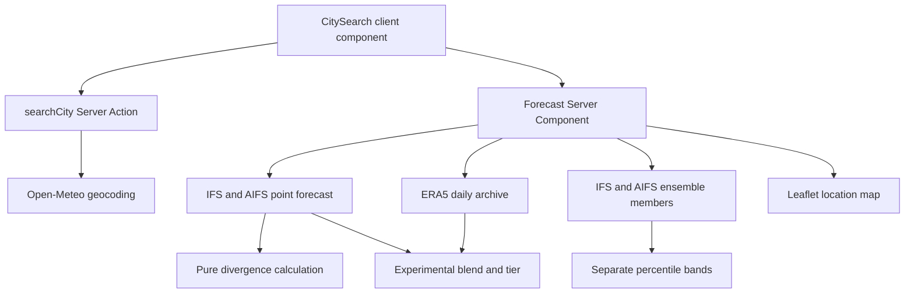

# Architecture

PreciCast is a Next.js App Router application deployed on Vercel. This document describes the implemented system. The original design and thresholds remain in [IMPLEMENTATION_PLAN.md](IMPLEMENTATION_PLAN.md).

## Request flow

The forecast page imports server data functions directly. It does not call its own `/api` routes. The point forecast is fetched first so its dates can determine the historical query. Ensemble and archive requests then run concurrently and fail independently.

## Data contracts and handling

- `lib/openMeteo.ts` validates HTTP status, JSON shape, matched series lengths, date format, and millimetre units. Errors are typed as `WeatherApiError`.
- A `null` model value stays missing. The UI does not convert it to zero or run divergence or blending for that day. Small negative precipitation values down to −1 mm, observed in the provider response, are clamped to zero as rounding artefacts; larger negative or non-finite values fail validation.
- `lib/climatology.ts` requests ten complete calendar years of ERA5 daily precipitation. For each forecast day, it pools the same seasonal day ±10 days across those years, wrapping around New Year. February 29 is omitted from the seasonal calendar. It calculates an empirical 90th percentile and sample maximum and requires at least 150 usable days.
- `lib/consensus.ts` applies the original plan's 40/60, 65/35, and 80/20 IFS/AIFS weights by tier. A zero-rain forecast is always routine even if the local P90 is zero. The blend is labelled experimental because no precipitation backtest supports the weights.
- `getEnsembleForecast` retrieves daily precipitation for each IFS and AIFS ensemble member, calculates each model's own 10th and 90th percentiles and mean, and requires at least ten usable members per model. The two models are never merged.

## Caching and failure behavior

Point forecasts and geocoding use fresh requests. Ensemble requests use the Next.js Data Cache with a one-hour revalidation interval; ERA5 archive requests use 30 days. Vercel KV was in the original plan but is no longer available; see [Vercel's Redis documentation](https://vercel.com/docs/redis). This build needs no separate Redis resource.

A failed point request can use `public/cache/fallback-demo-data.json` only for a matching demo city **and only on the snapshot's forecast start date**. The page labels the snapshot and its fetch time. An expired or unmatched snapshot is rejected and a readable error appears. If ensemble or archive data fails, the point comparison remains visible and the unavailable section is replaced with a notice.

## Presentation

`app/forecast/[city]/page.tsx` renders the server data and daily rows. `EnsembleChart.tsx` uses Recharts for two independent bands. `MapSection.tsx` loads the Leaflet map on the client to avoid server-side DOM access. `LimitationsPanel.tsx` contains the approved scientific caveat. `app/forecast/[city]/loading.tsx` provides a navigation loading state.

## Open limitations

There is no backtest against observed rainfall, no empirically calibrated tier or divergence threshold, and no dedicated uptime or rate-limit monitoring. The static fallback is intentionally short-lived to avoid showing old forecasts as current. The map pin marks requested coordinates; the provider may choose a nearby model grid cell.
