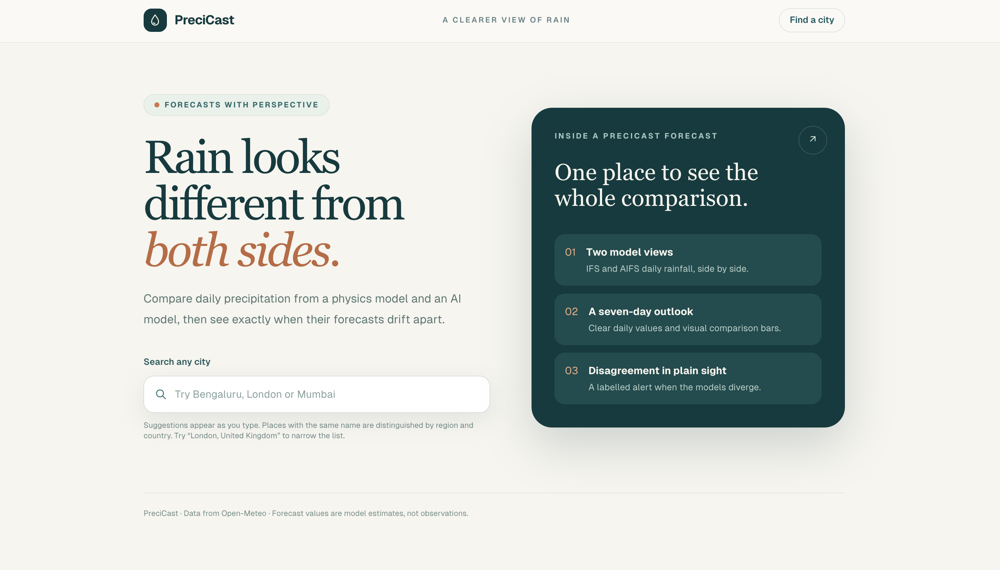

<p align="center"></p>

# PreciCast

PreciCast compares seven-day rainfall forecasts from ECMWF's physics-based IFS and AI-based AIFS models. Search for a city to see daily amounts, model disagreement, separate ensemble ranges, historical context, and a location map. Forecasts are estimates; disagreement does not show which model will be right.

**[Live app](https://precipitation-forecast.vercel.app/)** · **[Demo video](submission/precicast-demo.mp4)** · **[Audit and limitations](AUDIT_REPORT.md)**



## Tech stack

- **App:** Next.js App Router, React, TypeScript, Tailwind CSS
- **Charts and map:** Recharts, Leaflet, OpenStreetMap
- **Data:** Open-Meteo APIs for ECMWF forecasts, ensembles, geocoding, and ERA5 reanalysis
- **Deployment:** Vercel; Next.js Data Cache for ensemble and historical responses

## How it works

The server fetches IFS and AIFS forecasts for the selected coordinates and compares their daily precipitation totals in millimetres. A transparent threshold flags days when their difference exceeds `max(2 mm, 25% of the larger forecast)`. The weighted blend and historical severity labels are **experimental**, not calibrated accuracy claims. Missing live forecasts produce a retry message rather than stale demo data.

## Run locally

```bash
npm ci
npm run dev
```

Open `http://localhost:3000`. No API key is needed for non-commercial demo use. Run `npm test`, `npm run check`, and `npm run build` to verify the code.

## Evaluation and limits

In a small retrospective comparison of **120 city-days against ERA5 reanalysis**, mean absolute error was **2.204 mm for AIFS**, **2.318 mm for a 50/50 blend**, **2.359 mm for PreciCast's weighted blend**, and **2.573 mm for IFS**. The proposed weighting did not beat AIFS in this sample. ERA5 is not independent rain-gauge truth, so the result does not establish general rainfall skill.

Observed-rainfall validation, blend retuning, and badge calibration remain future work. See the [audit](AUDIT_REPORT.md) for methods, checks, and remaining limitations; [architecture](ARCHITECTURE.md) documents the design.
